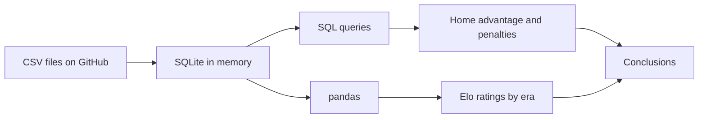

# ⚽ International Football Analysis

**Who ruled each era of international football, how big is the home advantage, and do penalties explain it?**
 

 

 

---
 
## 🎯 Questions
 
1. 🏆 Which national teams were the strongest in each historical era?
2. 🏠 Do teams score more goals at home than away?
3. 🥅 Do home teams score more penalties, and does this explain the home advantage?
## 📌 Key findings
 
### 🏆 Elo ratings by era
 
Ratings are reset to 1000 at the start of each era, so teams are compared within the same period.
 
| Era | 🥇 1st | 🥈 2nd | 🥉 3rd |
|---|---|---|---|
| 1872–1945 | Italy (1289) | Argentina (1278) | Brazil (1220) |
| 1946–1969 | England (1300) | Germany (1270) | Brazil (1233) |
| 1970–1989 | Brazil (1328) | Netherlands (1304) | South Korea (1303) |
| 1990–2009 | Spain (1446) | Brazil (1423) | Netherlands (1373) |
| 2010–now | Spain (1613) | Argentina (1492) | England (1477) |
 
Brazil is in the top three in each of the first four eras but only 12th in 2010–now.
 
### 🏠 Home advantage
 
- Among **155 teams** with at least 50 home and 50 away matches (friendlies and neutral venues excluded), **only Barbados** scores fewer goals per match at home than away.
- The **median home/away ratio is 1.68**: a typical team scores about 70% more goals per match at home.
- Strongest home effect: Niger (3.52), Libya (3.10), Bolivia (2.54).
### 🥅 Penalties
 
| | Home | Away |
|---|---|---|
| Scored penalties per match | **0.140** | 0.089 |
| Share of goals from penalties | 7.07% | 6.65% |
 
48 of 55 teams score more penalties per match at home, but penalties make up almost the **same share of goals** at home and away. Home teams score more penalties mainly because they score more goals overall, so penalties explain very little of the home advantage.
 
## 🧭 How it works
 

 
- **Elo:** all teams start at 1000, ratings update after every match in chronological order, friendlies are excluded. K-factor depends on the tournament: major finals 60, qualifiers and Nations League 40, other matches 30.
- **Eras:** 1872–1945, 1946–1969, 1970–1989, 1990–2009, 2010–now. Boundaries follow major changes in international football and are approximate.
- **SQL and pandas:** CTEs, joins, `EXISTS` and aggregation in SQL; filtering and summary statistics in pandas.
## 📂 Data
 
Source: [International football results from 1872 to 2017 (Kaggle)](https://www.kaggle.com/datasets/martj42/international-football-results-from-1872-to-2017).
The four CSV files used (`results`, `goalscorers`, `shootouts`, `former_names`) are stored in the [`Football data`](Football%20data) folder and loaded directly by the notebook, so no local setup is needed.
 
## ▶️ How to run
 
Click the **Open in Colab** badge above and choose **Runtime → Run all**.
 
## ⚠️ Limitations
 

Click to expand

- Elo does not model home advantage or goal difference, and renamed teams (e.g. USSR and Russia) are not merged. Teams that play mostly weak opponents, such as Jersey, can rank too high. Matches decided by penalty shootouts are counted as draws.
- `goalscorers` covers only about 32% of goals recorded in `results`, so penalty counts are underestimated; only the home–away comparison within each team is reliable. Only scored penalties are recorded, so awarded penalties cannot be analysed.
- The home advantage and penalty tables describe teams with long histories and do not represent smaller national teams.

## 🚀 Next steps
 
- [ ] Merge renamed teams using `former_names`
- [ ] Test how well Elo predicts match results
- [ ] Add visualisations in Plotly or Power BI
